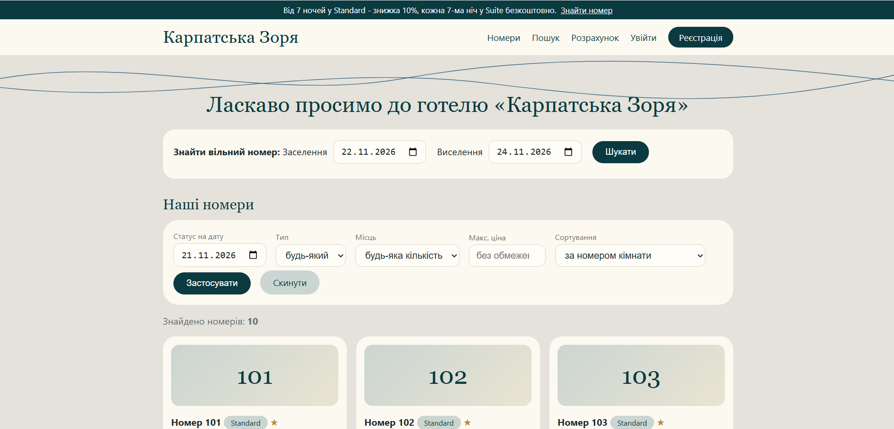
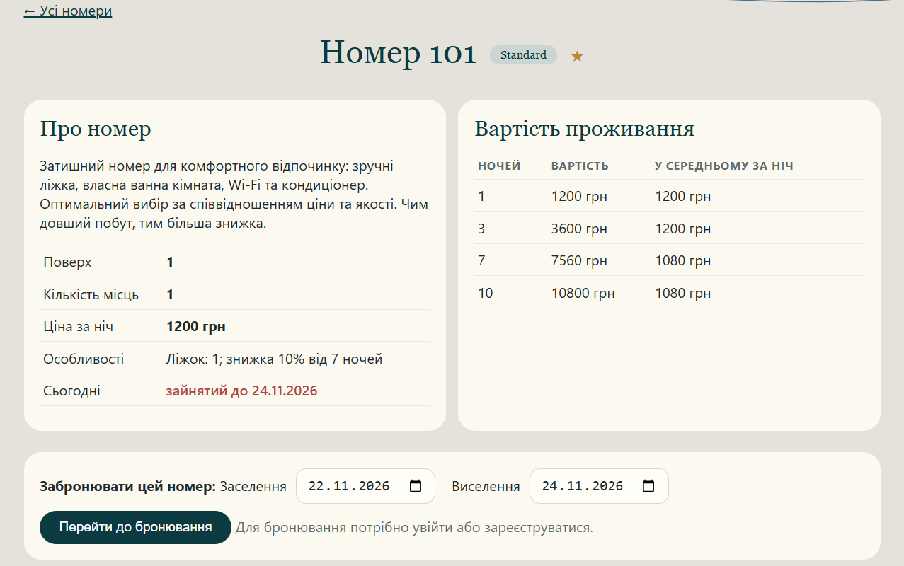
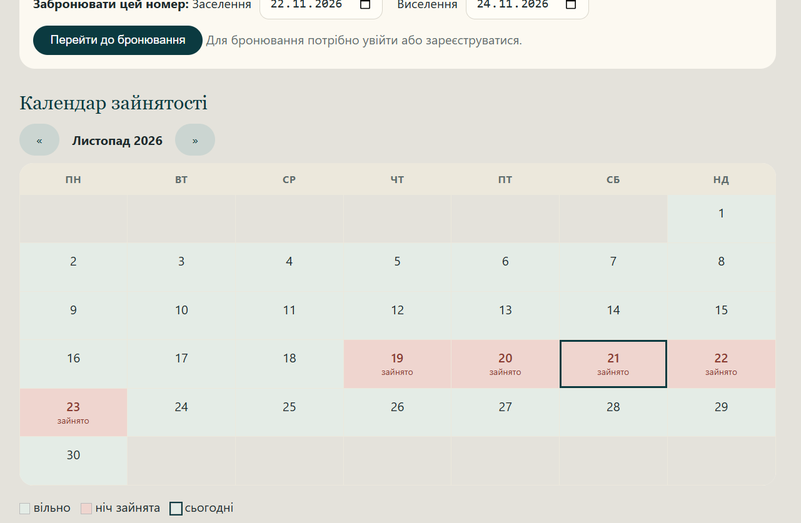
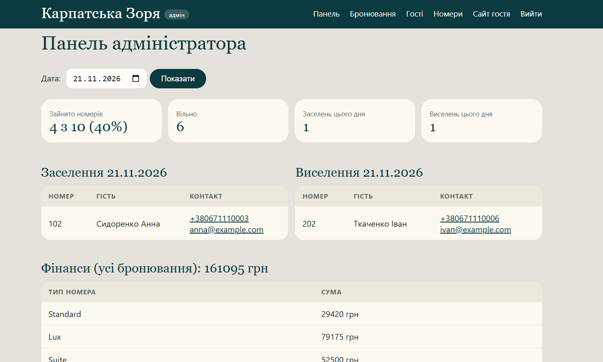

СИСТЕМА БРОНЮВАННЯ ГОТЕЛЮ (веб-додаток на Java)

ЗАПУСК В INTELLIJ IDEA
  1. File -> Open -> папка HotelBooking (папка src має бути позначена як Sources).
  2. Відкрийте src/Main.java -> зелений трикутник біля main -> Run 'Main.main()'.
  3. У панелі Run з'явиться "Сервер запущено!".
  4. Відкрийте у браузері: http://localhost:8080
  5. Зупинити сервер: червоний квадрат (Stop).

ВХІД (одна кнопка "Увійти" для всіх)
  Гість:          guest@example.com / guest123   (або зареєструйте власний акаунт) -> відкривається сайт клієнта
  Адміністратор:  admin@hotel.com / admin123     -> відкривається панель адміністратора
  Дані адміністратора змінюються в Main.java (ADMIN_EMAIL, ADMIN_PASSWORD).
  Зареєструватися на пошту адміна неможливо.

Maven, Tomcat, Spring НЕ потрібні (вбудований в Java HttpServer, потрібна Java 11+).
Порт 8080 зайнятий? Змініть число в Main.java.

РОЛІ (вхід спільний, після входу система сама відкриває потрібну частину)
  ВІДВІДУВАЧ (без входу): каталог номерів, фільтри, сортування, деталі номера, пошук, розрахунок.
  ГІСТЬ (/login, /register): бронює номери (контакти беруться з профілю),
        /my - свої бронювання, скасування ще не розпочатих.
  АДМІНІСТРАТОР (/login за поштою адміна): усі бронювання з контактами гостей (телефон, пошта),
        список гостей, керування цінами і номерами, календар номера з іменами.

СОРТУВАННЯ І ФІЛЬТРИ (головна сторінка і пошук)
  Сортування: ціна за зростанням / спаданням, престижність (Suite > Lux > Standard) в обидва боки.
  Фільтри: тип номера, мінімальна кількість місць, максимальна ціна.

КОНТАКТИ ГОСТЯ
  Під час реєстрації - ім'я, пошта, телефон (з перевіркою формату) і згода на обробку даних.
  Під час бронювання телефон можна уточнити. Контакти бачить лише адміністратор і сам гість.
  Паролі зберігаються як хеш SHA-256, а не відкритим текстом.

ДЕМО-ДАНІ створюються відносно СЬОГОДНІШНЬОЇ дати. Дані зберігаються в пам'яті:
після перезапуску сервера зміни зникають.

КЛАСИ
  Room (abstract) <- Standard, Lux, Suite   (calculatePrice, getCapacity, getPrestige - поліморфізм)
  Booking, Hotel, User, Validator, DateUtil (власний календар)
  WebServer (сторінки), Main (запуск), ConsoleApp (консольна версія, запасний варіант)

# Система бронювання готелю

Веб-додаток на Java: каталог номерів, бронювання з календарем зайнятості, акаунти гостей і панель адміністратора.

## Скриншоти

### Головна

### Сторінка номера

### Календар

### Адмін-панель
